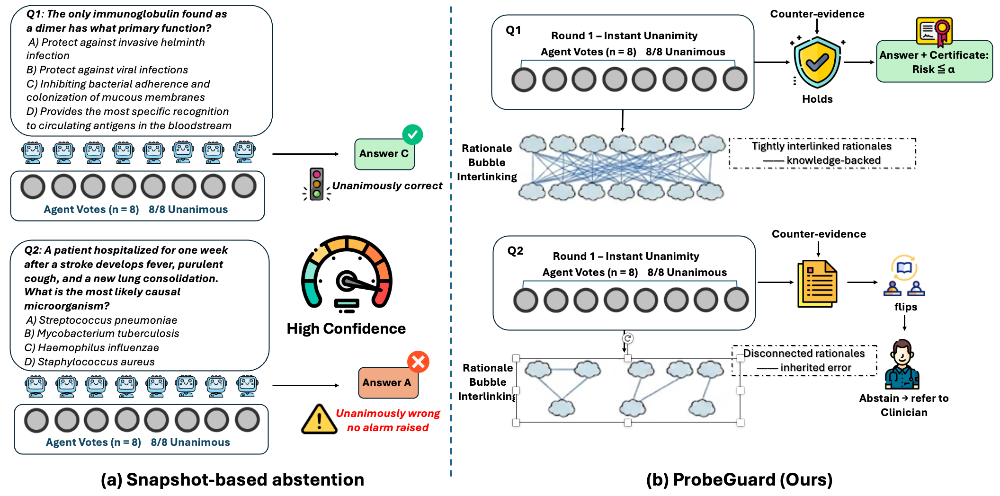
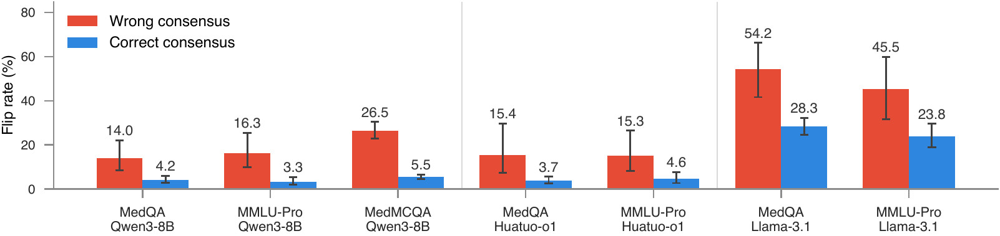
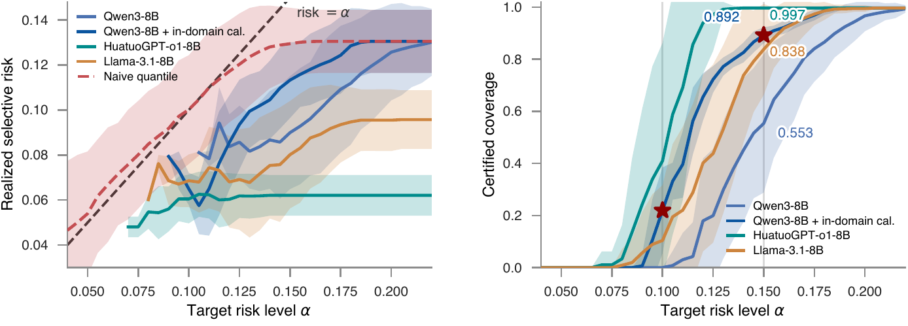

<div align="center">

# Unanimously Wrong: Certified Abstention from How Medical LLM Consensus Forms

**Xiaoyang Wang<sup>1</sup> &nbsp;·&nbsp; Tianrui Wang<sup>2</sup> &nbsp;·&nbsp; Christopher C. Yang<sup>1</sup>**

<sup>1</sup>Drexel University &nbsp;&nbsp; <sup>2</sup>University of Michigan, Ann Arbor

[](https://genai4health.github.io/2026-NeurIPS/) [](requirements-analysis.txt) [](LICENSE)
<!-- arXiv badge, to be added when the identifier is assigned:
[](https://arxiv.org/abs/XXXX.XXXXX)
-->

</div>

<p align="center">
  
</p>

**Figure 1** | Two unanimous votes are indistinguishable to agreement-based abstention (a). ProbeGuard (b) checks whether the rationales behind a unanimous vote support one another, tests the vote against retrieved counter-evidence, and answers only where selective risk is certified.

Multi-round medical QA systems sample several answers, retrieve evidence when the answers disagree, and stop once they agree. Agreement is then the confidence signal. On MedQA, 13.4% of the questions that reach first-round unanimity are answered wrongly, and on those questions every agreement-based signal is constant. ProbeGuard decides whether to answer from how the consensus formed: trajectory features from the execution log, rationale semantic entropy and a counter-evidence probe for unanimous votes, and a stratified Learn-then-Test calibration that bounds the selective risk of the answered questions.

This repository contains the abstention layer, the per-question records of every experiment in the paper, and the scripts that regenerate each table and figure from those records. The regeneration needs no GPU and no model access: about five minutes on a laptop CPU.

## Results

Discrimination of correct from incorrect final answers, AUROC on the Qwen3-8B substrate (Table 2 of the paper; the process score also has the lowest selective risk on MedQA and MedMCQA):

| Signal | MedQA | MMLU-Pro (medicine) | MedMCQA |
|---|:---:|:---:|:---:|
| Terminal agreement | 0.512 | 0.504 | 0.507 |
| First-round agreement | 0.677 | 0.698 | 0.640 |
| Sequence log-probability | 0.400 | 0.474 | 0.534 |
| Answer entropy | 0.681 | 0.703 | 0.641 |
| Verbalized confidence | 0.585 | 0.651 | – |
| P(True) | 0.602 | 0.644 | – |
| **ProbeGuard process score** | **0.696** | **0.704** | **0.659** |

Terminal agreement is at chance because the system stops when the candidates agree. The pattern holds on the other backbones: 0.775 against 0.519 on HuatuoGPT-o1-8B and 0.825 against 0.548 on Llama-3.1-8B (MedQA, Table 3).

Questions whose eight first-round candidates agree immediately are where a wrong answer is hardest to catch:

| | MedQA | MMLU-Pro (medicine) | MedMCQA | MedXpertQA |
|---|:---:|:---:|:---:|:---:|
| Share of questions with a unanimous first round | 59% | 59% | 55% | 29% |
| Wrong answers among them | 13.4% | 17.7% | 22.3% | 79.0% |

On this layer every vote-based signal is constant. Rationale semantic entropy separates correct from incorrect unanimity at 0.587 AUROC (MedQA) and 0.613 (MMLU-Pro); the counter-evidence probe reaches 0.642, 0.638 and 0.729 on the three benchmarks, and the two combined reach 0.685 and 0.688 on the two primary ones.

<p align="center">
  
</p>

**Figure 3** | Share of unanimous votes that change under retrieved counter-evidence, by backbone and benchmark, with Wilson 95% intervals. Wrong consensus flips more often than correct consensus in every cell. Control arms (Table 6) attribute the flips to the content of the retrieved documents: the devil's-advocate instruction alone flips none of the 746 MedQA votes.

Certification on the MedQA unanimous layer, 50 random calibration/test splits, family-wise error budget δ = 0.05 (Section 4.4):

| Calibration data | Target risk α | Certified coverage | Realized risk | Splits above α |
|---|:---:|:---:|:---:|:---:|
| Half of the layer (373 questions) | 0.15 | 0.553 ± 0.038 | 9.0% | 0 / 50 |
| Half of the layer + 875 in-domain questions | 0.15 | 0.892 ± 0.004 | 11.3% | 0 / 50 |
| Half of the layer + 875 in-domain questions | 0.10 | 0.219 ± 0.023 | 6.5% | 0 / 50 |

Coverage is the mean over splits with its standard error. Without added calibration data, HuatuoGPT-o1-8B certifies 0.410 of its unanimous layer at α = 0.10 and 0.997 at α = 0.15, and Llama-3.1-8B certifies 0.838 at α = 0.15. Every vote-based signal is constant on this layer and certifies nothing.

<p align="center">
  
</p>

**Figure 4** | Left: realized selective risk against the target level; every Learn-then-Test arm stays below the diagonal at every level it certifies, while naive quantile calibration crosses it. Right: certified coverage per backbone; stars mark the two operating points above.

## Reproduce the paper from the stored records

Every number, table and figure in the paper is regenerated from `results/` by the commands below. Tested with Python 3.10.

```bash
git clone https://github.com/wangxiaoyang0412/probeguard.git
cd probeguard
python -m venv .venv && source .venv/bin/activate
pip install -r requirements-analysis.txt
python analysis/holes.py h3          # certification on the MedQA unanimous layer
```

Expected output of the last command:

```
== h3 repeated splits R=50 on MedQA S1 (n=746) ==
  α=0.10: coverage=0.000±0.000 (nonzero in 0/50) risk|answered=nan±nan
  α=0.15: coverage=0.553±0.038 (nonzero in 43/50) risk|answered=0.0900±0.0038
  α=0.20: coverage=0.967±0.008 (nonzero in 50/50) risk|answered=0.1257±0.0030
```

| Paper item | Command | Writes |
|---|---|---|
| Tables 2, 3 and 5: AUROC | `python -m abstain_layer.t3_evaluate --features results/features_*.csv --out-dir outputs/tables` | `outputs/tables/auroc_table_*.csv`, `risk_coverage_*.csv` |
| Tables 2, 3 and 5: AURC | `python analysis/aurc_table.py --out-prefix outputs/tables/aurc_table` | `outputs/tables/aurc_table_*.csv` |
| Figure 2 (consensus formation) | `python analysis/fig_formation.py --out outputs/fig_formation` | `outputs/fig_formation.pdf` |
| Section 4.3: unanimous-layer AUROC of keep rate, rationale entropy and their combination | `python analysis/probe_analysis.py` | stdout |
| Figure 3 (flip rates) | `python analysis/fig_flip.py --out outputs/fig_flip` | `outputs/fig_flip.pdf` |
| Table 6 (probe control arms) | `python analysis/probe_ctrl_eval.py` | stdout |
| Section 4.4: certification, MedQA unanimous layer | `python analysis/holes.py h3` | stdout |
| Section 4.4: certification with in-domain calibration data | `python analysis/c8_fuel_cert.py` | stdout |
| Figure 4 (validity and coverage across α, all backbones) | `python analysis/fig_cert.py --out outputs/fig_cert` | `outputs/fig_cert.pdf`, stdout |
| Figure 5 (risk-coverage curves) | `python analysis/fig_rc.py --out outputs/fig_rc` | `outputs/fig_rc.pdf` |
| Table 5 (all signals, benchmarks and backbones) | `python analysis/gen_appendix_f.py --out outputs/tables/tab_full_results.tex` | LaTeX tabular |
| Table 7 (drop-one ablation) | `python analysis/gen_appendix_g.py --out outputs/tables/tab_ablation.tex` | LaTeX tabular |
| Table 8 (per-specialty certification) | `python analysis/c9_specialty.py --out outputs/tables/tab_specialty.tex` | LaTeX tabular |

The AUROC evaluation over all eight feature files takes about three and a half minutes; every other command finishes in seconds. The three LaTeX tables are byte-identical to the ones in the paper. `results/README.md` describes every stored record.

## Method in brief

The substrate is a multi-round agentic RAG system for medical QA. At each round it samples N = 8 candidate answers with rationales, retrieves evidence when they disagree, and stops at unanimity or after eight rounds. ProbeGuard adds a logging layer and leaves the decision logic unchanged.

1. **Process features.** 34 features in five families (agreement dynamics, answer-distribution dynamics, minority persistence, rationale signals, retrieval saturation) computed from the execution log and combined by ℓ2-regularized logistic regression under question-level cross-validation. Definitions were frozen before evaluation data were inspected: `registry.md`; code: `abstain_layer/features.py`, `abstain_layer/t3_evaluate.py`.
2. **Evidence signals for unanimous votes.** *Rationale semantic entropy* scores the mutual entailment among the concluding claims of the eight rationales with an NLI model (`abstain_layer/rationale_features.py`, `abstain_layer/soft_nli.py`). The *counter-evidence probe* generates queries for alternative answers, retrieves with the system's own stack, lets all eight candidates re-answer, and records the *keep rate* (`abstain_layer/probe_pilot.py`; control arms in `abstain_layer/probe_control.py`).
3. **Stratified certification.** Within each stratum (unanimous first round; contested but converged; never converged) a threshold is selected by Learn-then-Test over a coverage grid with exact binomial tests and a Bonferroni correction (`abstain_layer/phase1_conformal.py`, function `ltt_threshold`). The returned threshold satisfies P[ selective risk ≤ α ] ≥ 1 − δ whenever calibration and deployment questions are i.i.d. within the stratum.

## Run the full pipeline

The generation, probing and NLI stages need the substrate, a retrieval service and a served backbone. The paper's experiments ran on one node with six A40 GPUs; no API models were used.

<details>
<summary>Substrate, patches and environment</summary>

```bash
git clone https://github.com/NJU-RL/MA-RAG.git vendor/MA-RAG
git -C vendor/MA-RAG checkout 423f031cc0ffca679a047c885be999b9604100a9
for p in patches/000[1-4]-*.patch; do git -C vendor/MA-RAG apply "$PWD/$p"; done
for p in patches/0005*.patch; do patch -p2 -d vendor/MA-RAG < "$p"; done
pip install -r requirements.txt
```

The six patches apply cleanly to that commit. They fix environment paths, response-format handling across backbones and a bounded retry; none touches the consensus decision logic. Serve the backbone with vLLM 0.10.0 and start the substrate's retrieval service (BM25 with MedCPT reranking over MedCorp) as described in the MA-RAG repository.

</details>

<details>
<summary>Stages</summary>

Each module prints its options with `--help`.

| Stage | Module | Output |
|---|---|---|
| Generation with logging | `python -m abstain_layer.run_instrumented --vendor-dir vendor/MA-RAG ...` | per-question round logs under `runs/` |
| Log aggregation | `python -m abstain_layer.convert_logs --evaluations-dir ... --dataset ... --out ...` | one JSONL per dataset |
| Feature extraction | `python -m abstain_layer.t2_extract --jsonl ... --out results/features_<dataset>.csv --nli-device cuda:0` | feature table |
| Soft rationale aggregates | `python -m abstain_layer.soft_nli --jsonl ... --out-csv results/soft_f3_<dataset>_ua.csv --device cuda:0` | pairwise NLI aggregates on the unanimous layer |
| Counter-evidence probe | `python -m abstain_layer.probe_pilot --vendor-dir vendor/MA-RAG --full-jsonl ... --all-unanimous --out results/probe_<dataset>_ua.jsonl` | per-question probe records |
| Probe control arms | `python -m abstain_layer.probe_control --arm {nodocs,randdocs,neutral} ...` | control-arm records |
| Self-report baselines | `python -m abstain_layer.verbalized_conf ...`, `python -m abstain_layer.ptrue_conf ...` | per-question confidence records |
| Discrimination and certification | the commands of the table above | tables and figures |

Prompts are reproduced verbatim in Appendix A of the paper and hyperparameters in Appendix K; the random seed is 42 at every stage.

</details>

## Repository layout

```
abstain_layer/     instrumentation, feature extraction, probe, baselines, calibration
analysis/          scripts that produce each table and figure of the paper
results/           per-question records and summary tables (see results/README.md)
patches/           diffs applied to the substrate checkout
tests/             unit tests: schema, feature extraction, claim extraction, NLI aggregation
registry.md        frozen feature registry
assets/            figures used in this README
LICENSE            MIT
```

Run the tests with `pytest -q` (32 tests, a few seconds).

## Citation

```bibtex
@inproceedings{wang2026unanimously,
  title     = {Unanimously Wrong: Certified Abstention from How Medical {LLM} Consensus Forms},
  author    = {Wang, Xiaoyang and Wang, Tianrui and Yang, Christopher C.},
  booktitle = {NeurIPS 2026 Workshop on GenAI for Health (GenAI4Health)},
  year      = {2026}
}
```

## License and acknowledgments

The code in this repository is released under the MIT License. ProbeGuard is built on the MA-RAG substrate of Wu et al. (ICML 2026), which remains under its own license, and uses the MedCorp corpus and MedCPT reranker released with MedRAG.

Questions: xw388@drexel.edu
